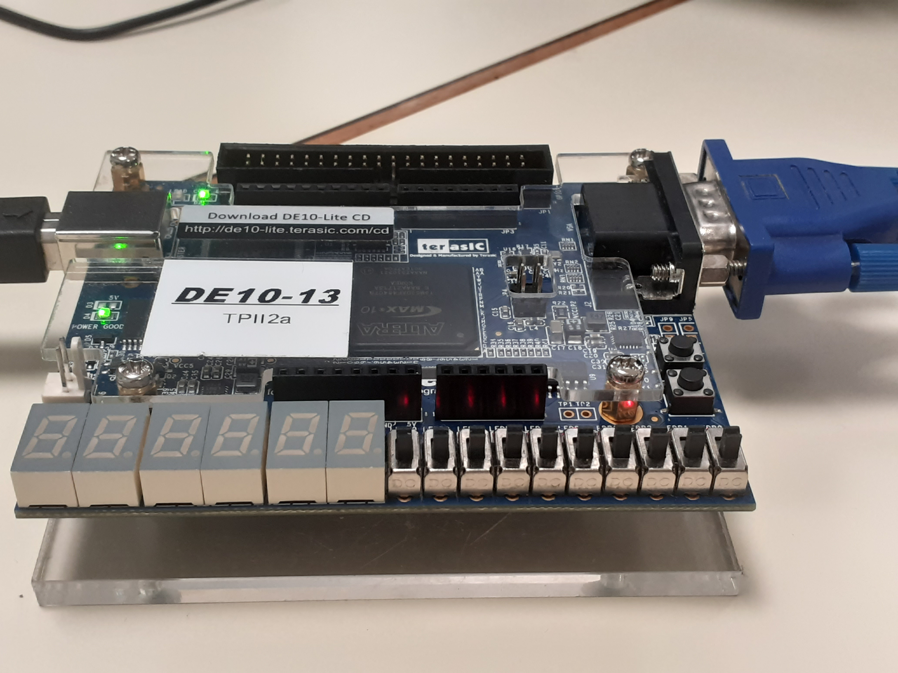
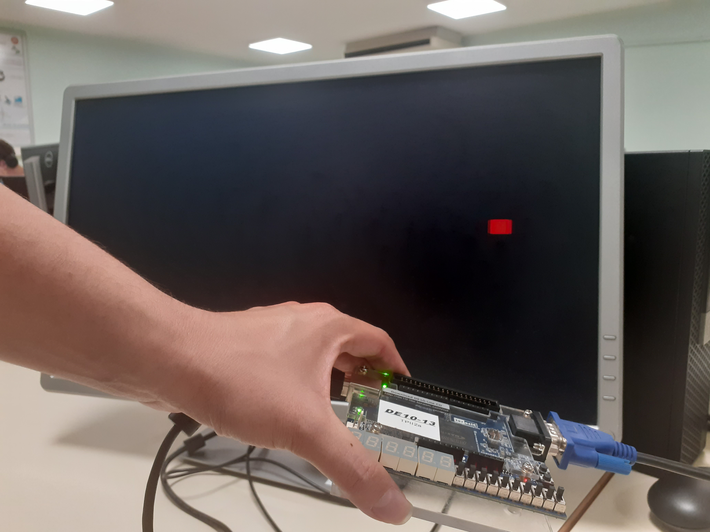
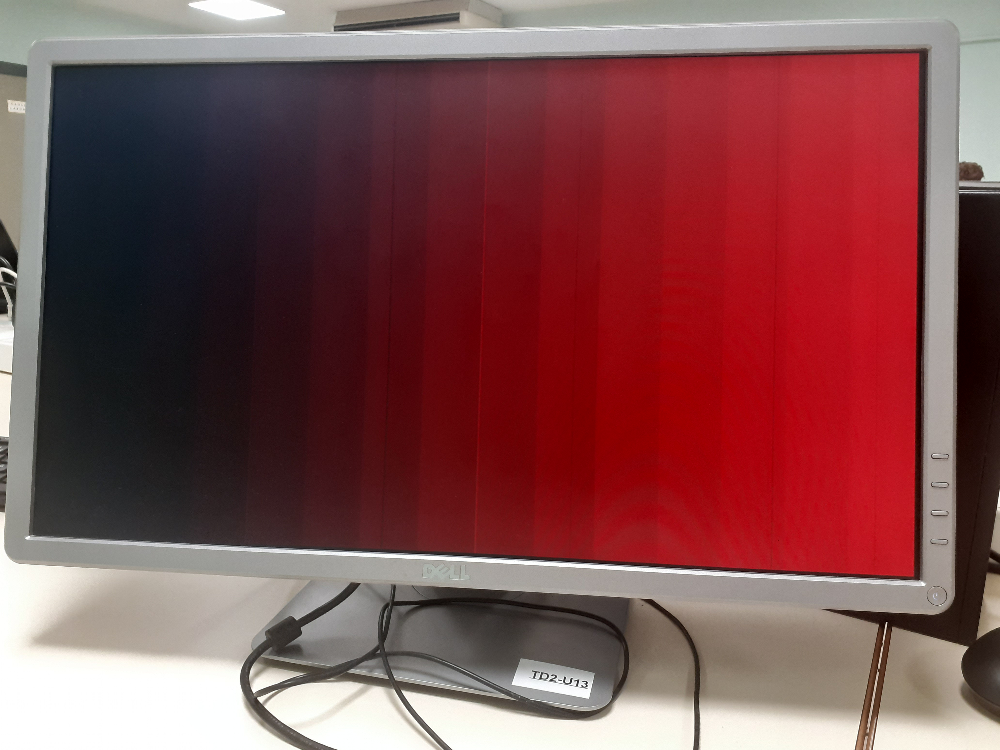
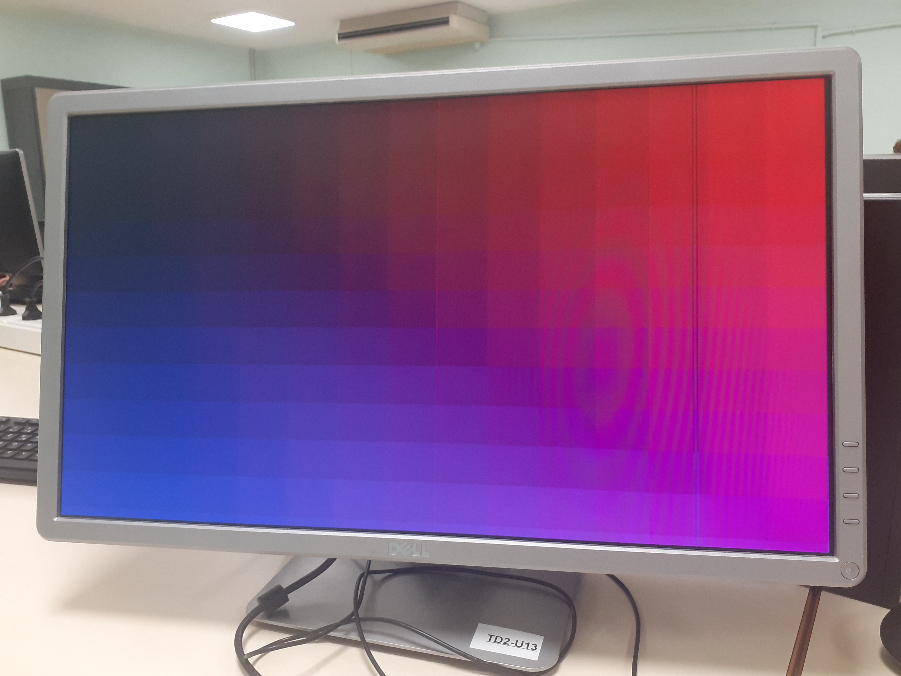

# FPGA VGA Display — DE10-Lite

VHDL exercises exploring VGA signal generation and graphical output on the **Terasic DE10-Lite (Intel MAX 10)** FPGA development board.

## Features

- **640 × 480 VGA timing:** horizontal and vertical synchronization, active-video region, and pixel coordinates.
- **Fixed red square:** 30 × 30 pixel shape.
- **Moving square:** horizontal motion controlled by a direction input, updated once per frame.
- **Grayscale gradient:** horizontal black-to-white intensity ramp.
- **RGB colors:** selectable red, green, and blue outputs.
- **Accelerometer-controlled square:** an RGB-generator example using signed X-axis acceleration values; the sensor interface is not included in this example.

## Repository layout

```text
src/common/                   VGA timing, clock divider, static top level
demos/fixed-square/           Fixed-square RGB generator
demos/moving-square/          Moving-square RGB generator
demos/grayscale-gradient/     Grayscale RGB generator
demos/rgb-colors/             RGB color selection top level
demos/accelerometer-square/   Accelerometer-driven RGB generator
docs/images/                  Photos of the original hardware demonstrations
```

## Modules and integration

For the **fixed square** or **grayscale gradient**, compile:

1. `src/common/FreqDiv.vhd`
2. `src/common/GeneSync.vhd`
3. `demos/fixed-square/GeneRGB.vhd` **or** `demos/grayscale-gradient/GeneRGB.vhd`
4. `src/common/VGA_Static.vhd` (top entity: `VGA_Static`)

For **RGB color selection**, use `FreqDiv.vhd`, `GeneSync.vhd`, and `demos/rgb-colors/VGA_Colors.vhd` (top entity: `VGA_Colors`).

The moving-square and accelerometer-square examples provide **RGB generator modules**, not complete board top levels. They need integration with timing and control signals; accelerometer control also requires an external sensor interface.

> The alternative `GeneRGB.vhd` files define the same VHDL entity. Compile **one variant at a time**.

## Hardware and verification

- Target board: **Terasic DE10-Lite**, Intel MAX 10 FPGA.
- VGA timing: **800 pixel clocks per line × 525 lines per frame**, including blanking and sync intervals.
- A 50 MHz input clock divided by two produces a 25 MHz pixel clock for the VGA timing logic.
- This repository contains **VHDL source only**; Quartus project files and FPGA pin assignments are not included.
- The source variants have **not yet been recompiled or simulated** in this repository. Testbenches and waveform results may be added later.
- Original photographs document the VGA outputs observed during the university hardware exercises. They do not constitute verification of every VHDL source variant included in this repository.

## Hardware Demonstration

The VGA display was demonstrated on a Terasic DE10-Lite FPGA development board connected to an external monitor.

### Hardware Setup



### Moving Square



### Color Gradients

**Red gradient**



**RGB gradient**




## Next steps

Add GHDL testbenches for synchronization, RGB output, and movement; verify each source variant independently before any further FPGA deployment.
